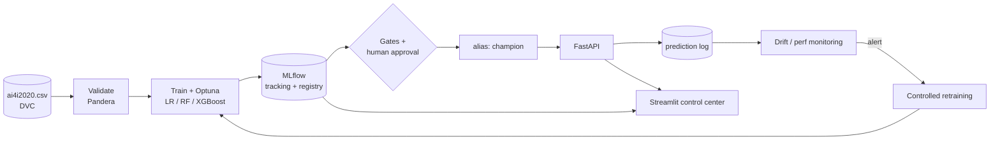

# ✈️ FlightOps ML
**Automated ML Pipeline for Predictive Maintenance** - an end-to-end, reproducible MLOps platform: data validation → training & tuning → experiment tracking → governed model registry → FastAPI serving → Streamlit control center → drift monitoring → controlled retraining → CI/CD.

> **Dataset caveat.** AI4I 2020 is a *synthetic* predictive-maintenance dataset, not real factory telemetry. The model estimates the probability of `Machine failure` from the current operating conditions; it does **not** forecast failures hours or days ahead. Production performance is not established.

## Business problem
Unplanned equipment failures cause downtime, maintenance cost, availability loss and lower productivity. FlightOps ML demonstrates how risk-based failure probabilities can help prioritise inspections - and, mainly, how to run such a model professionally (traceability, governance, monitoring).

## Architecture
See [`docs/architecture.md`](docs/architecture.md) for the full Mermaid diagram.



## Technology stack
Python 3.12 · pandas · scikit-learn · XGBoost · Optuna · SHAP · MLflow (tracking, registry, signatures, aliases) · DVC · Pandera · FastAPI/Pydantic/Uvicorn · Streamlit/Plotly · pytest/ruff/mypy · Docker Compose · GitHub Actions + CML. Evidently is supported as an *optional* extra (built-in PSI/KS drift works without it).

## Repository layout
```
src/flightops_ml/   data/ features/ training/ evaluation/ tracking/ registry/ monitoring/ inference/ reporting/ cli.py
api/                FastAPI app (routes/, schemas, metrics, dependencies)
dashboard/          Streamlit app.py + pages/ (10 pages) + components/ + services/
workers/            background training worker
configs/            training.yaml, model.yaml, monitoring.yaml
tests/              unit/ integration/ (synthetic fixtures; isolated SQLite MLflow)
docker/ docker-compose.yml   .github/workflows/ (ci, training, docker)   scripts/*.ps1   docs/   notebooks/
```

## Quick start (Windows 11 / PowerShell)

```powershell
git clone <your-repo-url> flightops-ml; cd flightops-ml
.\scripts\setup.ps1                    # venv, dependencies, .env
.\.venv\Scripts\Activate.ps1
```
**Data.** Download `ai4i2020.csv` from Kaggle ([AI4I 2020 notebook inputs](https://www.kaggle.com/code/yahyatantawi/machine-failure-prediction-ai4i-2020-dataset/input)) into `data\raw\`.
No dataset yet? Generate a **SYNTHETIC stand-in** that follows AI4I's published failure rules (it is *not* the real data; never report its numbers as AI4I results):
```powershell
.\scripts\train.ps1 -Demo              # generates data\raw\ai4i2020_synthetic_demo.csv and trains on it
```

### Train
```powershell
.\scripts\train.ps1 -Trials 30         # validate -> train 3 models -> tune XGBoost -> evaluate -> register candidate
python -m flightops_ml train --no-tune # faster, no Optuna
```
What happens: stratified 70/10/20 split (seed 42); preprocessing fitted on train only; XGBoost tuned with 5-fold stratified CV *inside train* (nested MLflow runs per trial); thresholds (default / best-F1 / recall-constrained / cost-based) chosen on **validation**; test split scored **once**; best model chosen by **validation PR-AUC**; registered as `EXPERIMENTAL` with alias `candidate`; gates run → `VALIDATED` if all pass.

### MLflow, API, dashboard
```powershell
.\scripts\run_local.ps1                # three windows: MLflow :5000, API :8000, Streamlit :8501
```
Without any server, everything also works against a local SQLite store (`mlflow_local/`) when `MLFLOW_TRACKING_URI` is unset. Open <http://localhost:5000> (MLflow), <http://localhost:8000/docs> (API), <http://localhost:8501> (dashboard).

### Govern: approve and deploy
```powershell
python -m flightops_ml registry status
python -m flightops_ml registry approve --version 1 --user alice --reason "reviewed"
python -m flightops_ml registry deploy  --version 1 --user alice      # sets alias `champion`
python -m flightops_ml registry rollback --user alice --reason "regression"
```
The dashboard's *Model Registry → Administration* offers the same actions behind `FLIGHTOPS_ADMIN_TOKEN`.

### Predict
```powershell
curl.exe -X POST "http://localhost:8000/predict?explain=true" -H "Content-Type: application/json" `
  -d '{"type":"M","air_temperature":298.1,"process_temperature":308.6,"rotational_speed":1551,"torque":42.8,"tool_wear":120}'
```
Response fields: `prediction`, `failure_probability`, `risk_level`, `model_version`, `threshold`, `request_id`, `timestamp`, optional SHAP `explanation`. Endpoints: `GET /health`, `/ready`, `/model/info`, `/metrics`; `POST /predict`, `/predict/batch`. There is intentionally **no** promotion endpoint.

### Docker
```powershell
Copy-Item .env.example .env
docker compose up --build -d
docker compose --profile train run --rm trainer
```
See [`docs/deployment.md`](docs/deployment.md). Experiments and the registry persist in named volumes across restarts.

### Tests
```powershell
.\scripts\test.ps1                     # ruff + config validation + pytest (writes reports\junit.xml)
```

## Dashboard pages
1 Executive Overview · 2 Data Explorer · 3 Training Lab (launch job, **live monitor**, **Training Replay**, controlled retraining) · 4 Experiment Tracking · 5 Model Evaluation (threshold tuning, ROC/PR, SHAP) · 6 Model Registry (+ admin) · 7 Model Lineage (interactive graph) · 8 Real-Time Predictions · 9 Model Monitoring (+ drift & adaptation simulations) · 10 CI/CD & System Health.

Honesty rules baked into the UI: training curves come from the real XGBoost evaluation history; *Training Replay* never retrains; moving a prediction slider only changes the inference input; simulated drift is always labelled synthetic; CI status is shown only if the GitHub API is configured.

## Model governance workflow
`EXPERIMENTAL → VALIDATED → APPROVED → DEPLOYED → ARCHIVED`, stored as version tags (MLflow stages are deprecated and not used); `candidate` / `champion` are aliases. Gates (`configs/model.yaml`): PR-AUC/recall/F1 floors, model loads & predicts from the registry, data validation passed, and - vs. the current champion on the same hold-out - PR-AUC not lower and recall not regressing beyond tolerance. Approval needs a named approver and a reason; every decision is appended to `artifacts/governance/events.jsonl`.

## Monitoring workflow
The API logs every prediction (features, probability, latency, version). Reports cover volume, latency, error and missing rates, PSI/KS drift per feature, prediction-distribution drift, and - **only when labels are uploaded** - precision/recall/F1/PR-AUC/FNR. Covariate drift, prediction drift and confirmed performance degradation are reported separately. `python -m flightops_ml monitor --simulate temperature_shift` runs a clearly-labelled synthetic scenario.

## Retraining
`python -m flightops_ml retrain --data new.csv --trigger new_labeled_data` (or via the dashboard): validate → check labels → version the dataset → train → compare with champion → register → gates → **stop** at "awaiting approval". Never auto-promoted.

## CI/CD
* `ci.yml` - ruff, mypy (advisory), config validation, leakage guard, full pytest on synthetic fixtures, Docker build check. Skips docs-only changes.
* `training.yml` - manual / weekly / PRs touching training code; pulls data via DVC when `DVC_REMOTE_URL` secrets exist, otherwise uses SYNTHETIC demo data and says so in the report; isolated SQLite MLflow; posts a **CML** report (`cml comment create`) to the PR; uploads artifacts. Permissions: `contents: read`, `pull-requests: write`.
* `docker.yml` - builds the 3 images; pushes to GHCR only on `v*` tags.

## Verification status (be aware)
Executed in the build environment: **70 automated tests pass** (3 Docker tests are skipped unless a stack is running), ruff clean, full CLI lifecycle (train → approve → deploy → monitor), live Uvicorn API calls, and all 10 Streamlit pages rendered with `streamlit.testing` against a real trained registry. Data used: SYNTHETIC AI4I-like fixtures.
**Not executed here:** the real AI4I 2020 CSV (not available offline), `docker compose build/up`, GitHub Actions workflows (YAML is syntactically valid only), DVC, Evidently, and the PowerShell scripts. Expect to fix small environment-specific issues on first run, and run `$env:FLIGHTOPS_DOCKER_TESTS=1; pytest -m docker` once the stack is up.

## Limitations & future work
Synthetic data and rule-generated failure modes; ~340 positives → wide metric uncertainty; illustrative cost ratio and risk bands; MLflow server unauthenticated (local use); SQLite log is single-node. Future: real sensor data, survival/RUL modelling, MLflow auth + remote artifact store, scheduled retraining service, calibrated probabilities, Prometheus/Grafana export, canary deployment.

## Screenshots
Add images of the dashboard pages under `docs/screenshots/` and reference them here after your first run.
