<div align="center">

# ✈️ FlightOps ML

**Automated ML pipeline for predictive maintenance — an end-to-end, governed MLOps platform**


[Quick start](#quick-start) · [Architecture](#architecture) · [Dashboard](#dashboard) · [Governance](#model-governance) · [API](#api-reference) · [CI/CD](#cicd) · [Limitations](#limitations)

</div>

---

> **Dataset caveat.** AI4I 2020 is a **synthetic** predictive-maintenance dataset, not real factory telemetry.
> The model estimates the probability of `Machine failure` from the *current* operating conditions. It does **not** forecast failures hours or days ahead, and production performance is **not established**.

## Table of contents

1. [Overview](#overview)
2. [Key features](#key-features)
3. [Architecture](#architecture)
4. [Technology stack](#technology-stack)
5. [Quick start](#quick-start)
6. [Usage](#usage)
7. [Dashboard](#dashboard)
8. [Model governance](#model-governance)
9. [Monitoring and retraining](#monitoring-and-retraining)
10. [API reference](#api-reference)
11. [Configuration](#configuration)
12. [CI/CD](#cicd)
13. [Testing and quality](#testing-and-quality)
14. [Repository structure](#repository-structure)
15. [Project status](#project-status)
16. [Limitations](#limitations)
17. [Roadmap](#roadmap)
18. [Author](#author)

## Overview

Unplanned equipment failures cause downtime, maintenance cost, availability loss and lower productivity.
FlightOps ML shows how risk-based failure probabilities can help prioritise inspections and, above all, how to operate such a model professionally: **traceability, governance, observability and controlled change**.

| Question | Answer |
|---|---|
| What does it predict? | Probability that a machine is in a failure state, given its operating conditions |
| On what data? | AI4I 2020 (10,000 observations, ≈ 3.4 % failures, synthetic) |
| What is the focus? | The MLOps lifecycle, not leaderboard accuracy |

## Key features

| Area | Capabilities |
|---|---|
| **Data engineering** | Pandera schema validation, quality report, dataset fingerprint (SHA-256, size, git commit), DVC integration, leakage guard |
| **Modelling** | Logistic Regression, Random Forest, XGBoost; Optuna tuning with stratified CV inside the training split; class-imbalance handling |
| **Evaluation** | Precision, recall, F1, PR-AUC, ROC-AUC, Brier, calibration, SHAP; four threshold strategies chosen on validation only |
| **Tracking** | MLflow parameters, metrics, artifacts, signatures, input examples, nested Optuna runs |
| **Governance** | Registry lifecycle via tags and aliases, validation gates, named human approval, rollback, append-only audit log |
| **Lineage** | Interactive graph from dataset to prediction records; missing links are reported, never fabricated |
| **Serving** | FastAPI serving the registry `champion` alias, batch endpoint, SHAP explanations, Prometheus-style metrics |
| **Monitoring** | PSI/KS drift, latency, error and missing rates; performance only when ground-truth labels exist |
| **Operations** | Controlled retraining, Docker Compose, GitHub Actions, CML reports |
| **Dashboard** | 10-page Streamlit control center including live training monitor and Training Replay |

## Architecture

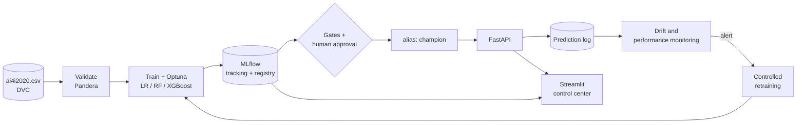

Design decisions, trade-offs and the module map are in [`docs/architecture.md`](docs/architecture.md).

**Evaluation protocol**

1. Stratified split 70 / 10 / 20 with a fixed seed; the test set stays untouched until final evaluation.
2. Preprocessing and feature engineering are fitted on the training split only.
3. Hyper-parameters are tuned with 5-fold stratified CV inside the training split.
4. Decision thresholds are chosen on **validation**; the test set is scored once per model.
5. The best model is selected by **validation PR-AUC**, never by accuracy alone.

## Technology stack

| Layer | Tools |
|---|---|
| ML | Python 3.12, pandas, scikit-learn, XGBoost, Optuna, SHAP |
| MLOps | MLflow (Tracking, Registry, Signatures, Aliases), DVC |
| Data quality & monitoring | Pandera, PSI/KS drift engine, Evidently (optional) |
| Serving | FastAPI, Pydantic, Uvicorn |
| UI | Streamlit, Plotly |
| Quality | pytest, ruff, mypy |
| Delivery | Docker, Docker Compose, GitHub Actions, CML |

## Quick start

### Prerequisites

- Windows 11 with PowerShell (the code itself is cross-platform)
- Python **3.12**
- Docker Desktop (only for the containerised stack)

### 1. Install

```powershell
git clone <your-repo-url> flightops-ml; cd flightops-ml
.\scripts\setup.ps1
.\.venv\Scripts\Activate.ps1
```

### 2. Get the data

Download `ai4i2020.csv` from [Kaggle](https://www.kaggle.com/code/yahyatantawi/machine-failure-prediction-ai4i-2020-dataset/input) into `data\raw\`.

No dataset yet? Generate a **synthetic stand-in** that follows AI4I's published failure rules. It is *not* the real data, so never report its numbers as AI4I results.

```powershell
python -m flightops_ml demo-data
$env:FLIGHTOPS_DATASET = "data/raw/ai4i2020_synthetic_demo.csv"
```

### 3. Run locally

```powershell
.\scripts\run_local.ps1                          # MLflow :5000 · API :8000 · Dashboard :8501
$env:MLFLOW_TRACKING_URI = "http://127.0.0.1:5000"
.\scripts\train.ps1 -Trials 30                   # add -Demo for synthetic data, -NoTune for speed
python -m flightops_ml registry approve --version 1 --user <you> --reason "metrics reviewed"
python -m flightops_ml registry deploy  --version 1 --user <you>
```

| Service | URL |
|---|---|
| Dashboard | <http://localhost:8501> |
| API docs | <http://localhost:8000/docs> |
| MLflow | <http://localhost:5000> |

### Or: Docker

```powershell
Copy-Item .env.example .env                      # set FLIGHTOPS_ADMIN_TOKEN
docker compose up --build -d
docker compose --profile train run --rm trainer
```

Experiments and the registry persist in named volumes across restarts. See [`docs/deployment.md`](docs/deployment.md).

## Usage

### Train

```powershell
python -m flightops_ml train --trials 30         # validate → train 3 models → tune → evaluate → register candidate
python -m flightops_ml train --no-tune           # faster, no Optuna
python -m flightops_ml train --models xgboost
```

### Predict

```powershell
curl.exe -X POST "http://localhost:8000/predict?explain=true" -H "Content-Type: application/json" `
  -d '{\"type\":\"M\",\"air_temperature\":298.1,\"process_temperature\":308.6,\"rotational_speed\":1551,\"torque\":42.8,\"tool_wear\":120}'
```

Response fields: `prediction`, `failure_probability`, `risk_level`, `model_version`, `threshold`, `request_id`, `timestamp`, optional SHAP `explanation`.

### Command-line reference

| Command | Purpose |
|---|---|
| `demo-data` | Write a synthetic AI4I-like CSV |
| `validate-data` | Schema validation and quality report |
| `train` | Full training pipeline and candidate registration |
| `registry status \| approve \| deploy \| rollback \| archive` | Governance actions (admin) |
| `retrain --data <csv>` | Controlled retraining; stops at "awaiting approval" |
| `monitor [--simulate <scenario>]` | Monitoring report or labelled synthetic drift |
| `cml-report` | Markdown report for pull requests |
| `leakage-check` | CI guard against target leakage |

## Dashboard

| # | Page | Highlights |
|---|---|---|
| 1 | Executive Overview | Champion, version, F1 / recall / PR-AUC, API and monitoring status |
| 2 | Data Explorer | Quality checks, class imbalance, distributions, correlations |
| 3 | Training Lab | Background training jobs, **live monitor**, **Training Replay**, controlled retraining |
| 4 | Experiment Tracking | Runs, parameters, metrics, artifacts, run comparison |
| 5 | Model Evaluation | Threshold tuning, ROC / PR curves, classification report, SHAP |
| 6 | Model Registry | Versions, gates, promotion history, token-protected admin panel |
| 7 | Model Lineage | Clickable provenance graph from real metadata |
| 8 | Real-Time Predictions | Machine-condition simulator calling the API |
| 9 | Model Monitoring | Drift, labels upload, synthetic drift and adaptation simulations |
| 10 | CI/CD & System Health | Service health, test report, GitHub workflow status when configured |

### Screenshots

<table>
<tr><td align="center">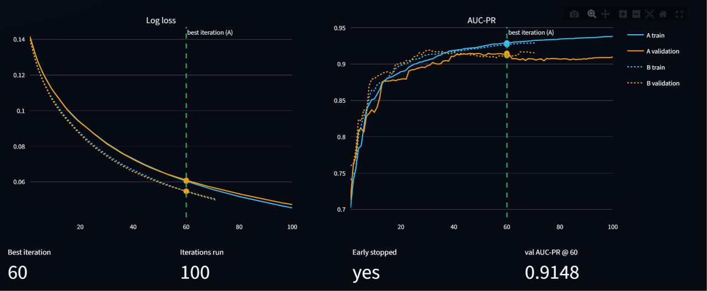<br><sub><b>1. Executive Overview</b></sub></td><td align="center">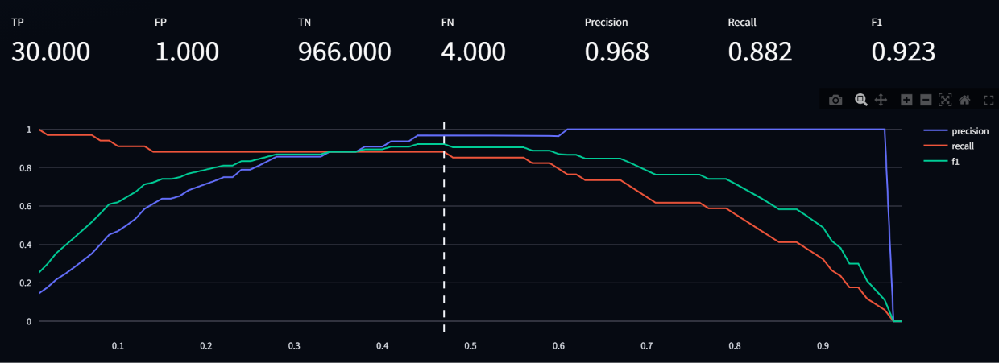<br><sub><b>2. Data Explorer</b></sub></td></tr>
<tr><td align="center">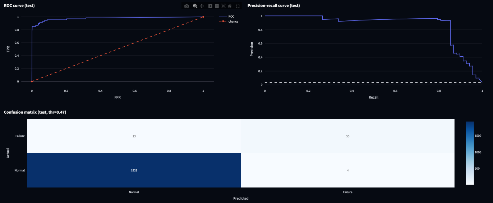<br><sub><b>3. Training Lab</b></sub></td><td align="center">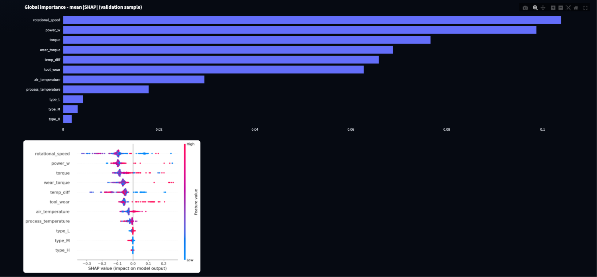<br><sub><b>4. Experiment Tracking</b></sub></td></tr>
<tr><td align="center">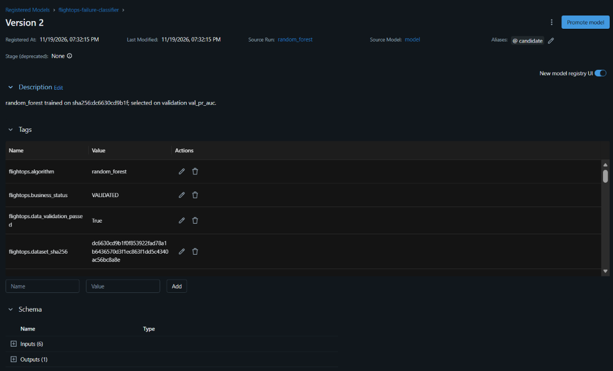<br><sub><b>5. Model Evaluation</b></sub></td><td align="center">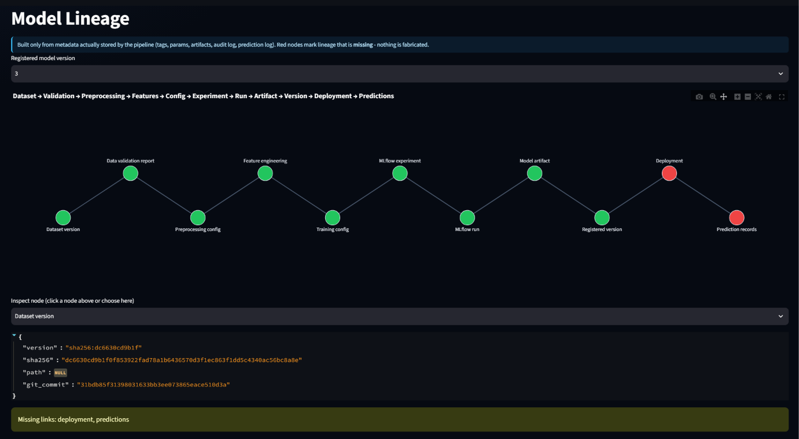<br><sub><b>6. Model Registry</b></sub></td></tr>
<tr><td align="center">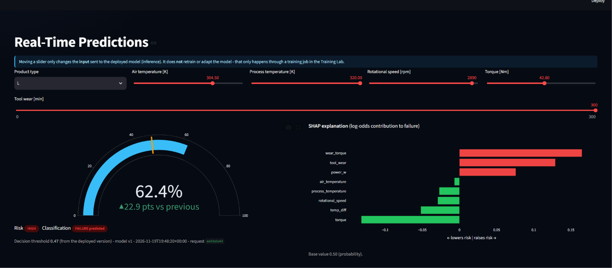<br><sub><b>7. Model Lineage</b></sub></td><td align="center">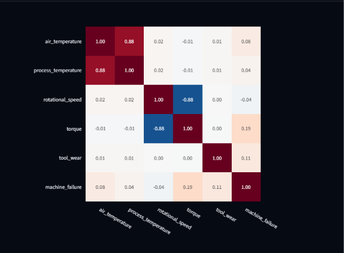<br><sub><b>8. Real-Time Predictions</b></sub></td></tr>
<tr><td align="center">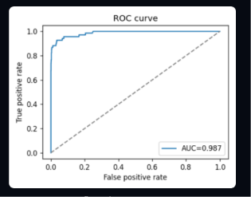<br><sub><b>9. Model Monitoring</b></sub></td><td align="center">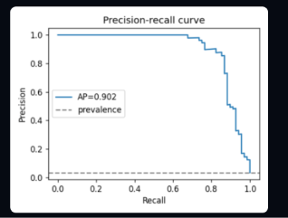<br><sub><b>10. CI/CD & System Health</b></sub></td></tr>
<tr><td align="center">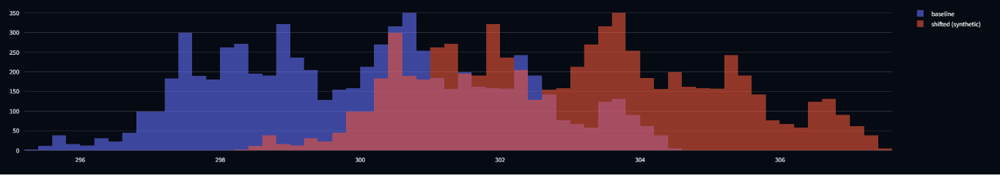<br><sub><b>11. Additional view</b></sub></td><td></td></tr>
</table>


**Honesty rules enforced in the UI:** training curves come from the real XGBoost evaluation history; Training Replay never retrains; moving a prediction slider only changes the inference input; simulated drift is always labelled synthetic; CI status is never shown unless the GitHub API is configured.

## Model governance

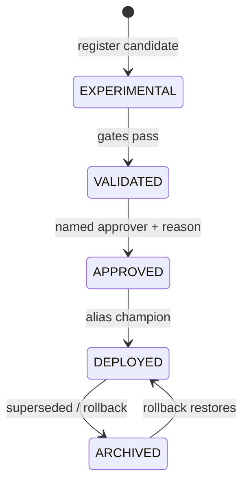

- Business status lives in **version tags**; `candidate` and `champion` are **aliases** (deprecated MLflow stages are not used). *Deployed* means "holds the `champion` alias".
- **Gates** (`configs/model.yaml`): PR-AUC / recall / F1 floors, model loads and predicts from the registry, data validation passed, and versus the current champion on the same hold-out: PR-AUC not lower, recall not regressing beyond tolerance.
- A new model **never** replaces the champion because accuracy is higher. Approval is manual.
- Every decision is appended to `artifacts/governance/events.jsonl`.
- There is **no promotion endpoint** in the API. Governance runs through the CLI or the token-protected admin panel.

Lineage covered end to end: dataset version → validation report → preprocessing → feature engineering → training config → experiment → run → artifact → registered version → deployment → predictions ([`docs/data_lineage.md`](docs/data_lineage.md)).

## Monitoring and retraining

**Monitoring** reports volume, latency, error and missing rates, PSI / KS drift per feature and prediction-distribution drift. Precision, recall, F1, PR-AUC and false-negative rate are computed **only when labels are uploaded**. Three concepts are never conflated:

| Concept | Needs labels? | Meaning |
|---|---|---|
| Covariate drift | No | Input distributions changed |
| Prediction drift | No | Predicted-probability distribution changed |
| Performance degradation | **Yes** | Confirmed loss of quality |

**Retraining** (manual, scheduled, new labelled data or monitoring alert): validate data → verify labels → version dataset → train → compare with champion → register → apply gates → **stop at awaiting approval**.

## API reference

| Method | Endpoint | Description |
|---|---|---|
| GET | `/health` | Liveness |
| GET | `/ready` | Readiness (champion model loaded) |
| GET | `/model/info` | Name, version, run ID, alias, feature schema, threshold |
| POST | `/predict` | One observation; `?explain=true` adds SHAP contributions |
| POST | `/predict/batch` | Up to 1,000 observations |
| GET | `/metrics` | Operational metrics (Prometheus text format) |

Optional `X-API-Key` protection on prediction endpoints via `FLIGHTOPS_API_KEY`. Interactive docs at `/docs`.

## Configuration

| File / variable | Purpose |
|---|---|
| `configs/training.yaml` | Seed, split, features, models, tuning, threshold strategy, selection rule |
| `configs/model.yaml` | Lifecycle, promotion gates, risk bands, serving settings |
| `configs/monitoring.yaml` | Drift thresholds, alert limits, simulation scenarios |
| `MLFLOW_TRACKING_URI` | Tracking server; unset = local SQLite in `mlflow_local/` |
| `FLIGHTOPS_API_URL` | API base URL used by the dashboard |
| `FLIGHTOPS_ADMIN_TOKEN` | Enables dashboard admin actions (disabled when empty) |
| `FLIGHTOPS_API_KEY` | Optional API key for prediction endpoints |
| `FLIGHTOPS_DATASET` | Override dataset path (e.g. the synthetic demo file) |

Copy `.env.example` to `.env` and never commit it.

## CI/CD

| Workflow | Trigger | What it does |
|---|---|---|
| `ci.yml` | push, pull request (skips docs-only) | ruff, mypy (advisory), config validation, leakage guard, pytest on synthetic fixtures, Docker build check |
| `training.yml` | manual, weekly, PRs touching training code | DVC data (or labelled synthetic fallback), isolated SQLite MLflow, **CML report** on the PR, artifacts upload |
| `docker.yml` | `v*` tags, manual | Builds the three images; pushes to GHCR on tags only |

Security: least-privilege permissions, secrets only via GitHub Secrets, and no laptop MLflow server is ever exposed to CI.

## Testing and quality

```powershell
.\scripts\test.ps1              # ruff + config validation + pytest (writes reports\junit.xml)
pytest tests/unit -q
pytest tests/integration -q
$env:FLIGHTOPS_DOCKER_TESTS = "1"; pytest -m docker    # against a running Docker stack
```

Coverage areas: schema, preprocessing, leakage, reproducibility, serialization, MLflow tracking and registry, promotion gates, thresholds, API validation, batch predictions, drift maths, lineage, jobs, retraining. All tests use synthetic fixtures and an isolated SQLite MLflow store, so no paid service is needed.

## Repository structure

```text
flightops-ml/
├── src/flightops_ml/   data · features · training · evaluation · tracking · registry
│                       monitoring · inference · reporting · cli.py
├── api/                FastAPI app (routes, schemas, metrics, dependencies)
├── dashboard/          Streamlit app.py · pages/ (10) · components/ · services/
├── workers/            Background training worker
├── configs/            training.yaml · model.yaml · monitoring.yaml
├── tests/              unit/ · integration/
├── docker/             Dockerfile.api · .dashboard · .mlflow
├── .github/workflows/  ci.yml · training.yml · docker.yml
├── scripts/            PowerShell helpers
├── docs/               architecture · model_card · data_lineage · deployment
├── notebooks/          EDA · baselines · explainability
├── docker-compose.yml · dvc.yaml · pyproject.toml · requirements*.txt
```

## Project status

| Verified in the build environment | Not yet verified |
|---|---|
| 70 automated tests passing (3 Docker tests skipped without a stack) | `docker compose build / up` |
| ruff and mypy clean | GitHub Actions runs (YAML syntax only) |
| Full CLI lifecycle: train → approve → deploy → monitor | Real AI4I 2020 CSV (synthetic stand-in used) |
| Live Uvicorn API calls, SHAP explanations | DVC, Evidently |
| All 10 dashboard pages rendered against a real trained registry | PowerShell scripts |

Expect small environment-specific fixes on the first Windows or Docker run.

## Limitations

- Synthetic data with rule-generated failure modes; engineered features mirror those rules, so high scores reflect the generator, not real equipment.
- Only ≈ 340 positive samples: metrics carry wide uncertainty.
- Risk bands and the illustrative cost ratio (FN = 10 × FP) are placeholders to replace with real maintenance economics.
- MLflow server has no authentication; keep it on localhost or a trusted network.
- Models are serialised with cloudpickle (custom transformer): load only models from your own registry.

Full details: [`docs/model_card.md`](docs/model_card.md).

## Roadmap

- [ ] Real sensor data and remaining-useful-life / survival modelling
- [ ] MLflow authentication and remote artifact store
- [ ] Scheduled retraining service
- [ ] Probability calibration
- [ ] Prometheus / Grafana export
- [ ] Canary deployment

## Author

**Salaheddine ES-AISSI ELISMAILI** — AI/ML Engineering student, ENSAJ (El Jadida, Morocco)

[LinkedIn](https://www.linkedin.com/in/salaheddine-es-aissi-elismaili) · [GitHub](https://github.com/SalaheddinE-ai)