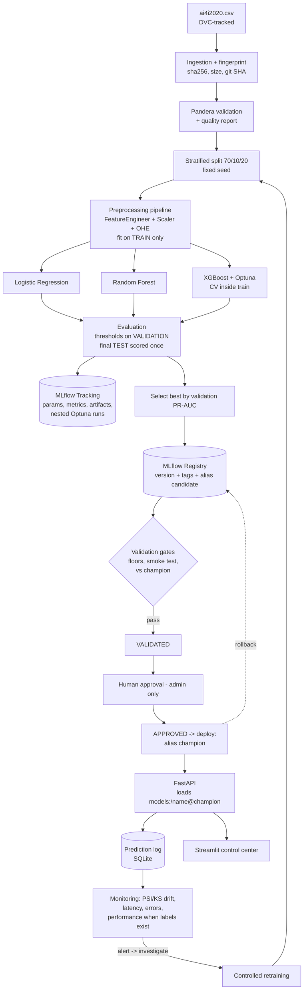

# Architecture

## Design decisions

| Concern | Decision | Why |
|---|---|---|
| Registry lifecycle | Business status in **version tags**; pointers via **aliases** (`candidate`, `champion`) | MLflow model *stages* are deprecated |
| "Deployed" | = version holding the `champion` alias | One source of truth; API re-resolves the alias periodically so promotion/rollback needs no restart |
| Model selection | Validation PR-AUC (tie: validation F1) | 3.4 % positives: accuracy is misleading; the test set must not guide selection |
| Thresholds | Four strategies computed on validation; one stored on the model version | The API must use the threshold the model was approved with |
| Promotion | Gates -> human approval -> deploy; never automatic | A higher accuracy alone must never replace the champion |
| Champion vs candidate | Both scored on the candidate's untouched hold-out set | Fair comparison; models/thresholds are already frozen, so no selection leakage |
| Serving | Registry model only (`models:/<name>@champion`), no stray `model.pkl` | Traceability of every prediction to a registered version |
| Governance surface | CLI + token-protected admin panel; **no** API endpoint | Prevents public promotion |
| CI MLflow | Isolated SQLite store per run, artifacts uploaded | Laptop MLflow is never exposed |
| Serialization | `cloudpickle` flavor | The pipeline embeds a custom `FeatureEngineer`; skops does not trust it. Acceptable because only models from our own registry are loaded |

## Module map

`src/flightops_ml/` - `data/` (ingestion, validation, preprocessing, synthetic generator) · `features/` · `training/` (train, tuning, callbacks, jobs, retraining) · `evaluation/` · `tracking/` (MLflow helpers, lineage) · `registry/` (registration, promotion, audit) · `monitoring/` (drift, report, prediction log, adaptation) · `inference/predictor.py` · `reporting/cml_report.py` · `cli.py`
